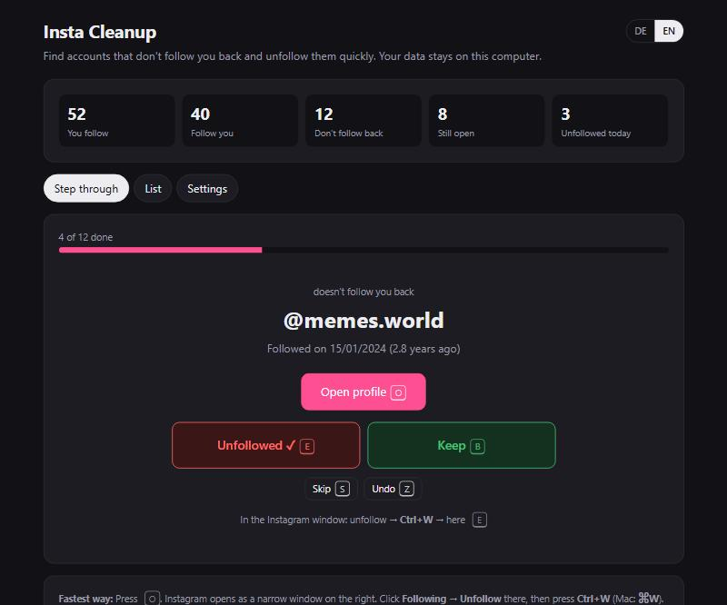

**English** | [Deutsch](README.de.md)

# Insta Cleanup

Find out who doesn't follow you back on Instagram and unfollow them quickly with your keyboard. The tool runs **entirely locally**, needs **no login** and **never clicks anything automatically** for you.

**[Open in your browser](https://honz221.github.io/insta-aufraeumen/)** · [How it works](#how-it-works) · [Support](#support)

You can also download `insta-aufraeumen.html` and open it with a double-click. The tool is available in English and German, and you can switch languages in the top right.

## Why another unfollow tool?

Most tools either want your Instagram password or unfollow automatically using scripts. Both break Instagram's Terms of Use and can get your account blocked. This tool works differently:

- 🔒 **Your data stays on your computer.** Nothing is uploaded, and there's no server and no tracking.
- 🙅 **No login, no automation.** You do the unfollowing yourself. The tool just makes it fast.
- ⌨️ **Fast step-through mode.** Each account takes only a few seconds: `O` opens the profile, you unfollow, close it with `Ctrl+W` and press `E`.
- ✅ **"Keep" marker.** Friends and favourite accounts never show up again.
- 🛑 **Daily limit with a warning**, so Instagram doesn't throttle you.
- 💾 **Back up your progress.** With your next export you'll only see new accounts.

## How it works

### 1. Request your Instagram export
1. Instagram → **Settings → Accounts Center**
2. **Your information and permissions → Download your information**
3. **Download or transfer information** → choose your Instagram account
4. **Some of your information** → select only **"Followers and following"**
5. **Download to device**: date range **All time**, format **JSON** (not HTML!)
6. After a few minutes you'll get an email with the download link

Instagram renames these menus from time to time, so the labels may differ slightly.

### 2. Drop the export into the tool
Just drop the ZIP file into the tool. The individual files `followers_1.json` and `following.json` work too.

### 3. Step through
| Key | Action |
|---|---|
| `O` | Open profile (as a narrow window on the right) |
| `E` | Unfollowed, go to the next one |
| `B` | Keep, never show again |
| `S` | Skip |
| `Z` | Undo |

The fastest flow: **Following → Unfollow → `Ctrl+W` (Mac: `⌘W`) → `E`**

> Why `Ctrl+W`? For security reasons, Instagram cuts the connection to the window that opened it. That's why the tool can't close the Instagram window itself.

### 4. Back up your progress
Your progress is saved in your browser automatically. To be safe, you can export it as a file under **Settings → "Save backup file"**. Next time, just drop your new export and the backup file into the tool together.

## Tip: accounts you no longer look at

Instagram has a feature for this. In the app, go to **Profile → Following → "Least interacted with"**.

## Notes

- Requires a recent browser (Chrome, Edge, Brave, Firefox, Safari). For ZIP files, [JSZip](https://stuk.github.io/jszip/) is loaded once from cdnjs.
- Deleted or renamed accounts show "Sorry, this page isn't available" on Instagram. Just skip past them with `E`.
- Instagram occasionally changes the export format. If something doesn't work, please open an issue.

## Support

The tool is free and will stay free. If it saved you time and you'd like to give something back:

**[Buy me a coffee on Ko-fi](https://ko-fi.com/honz221)**

A ⭐ for the repository makes me just as happy.

## Disclaimer

This project is not affiliated with Instagram or Meta Platforms, Inc. "Instagram" is a trademark of Meta Platforms, Inc. Use at your own risk.

## License

[MIT](LICENSE)
