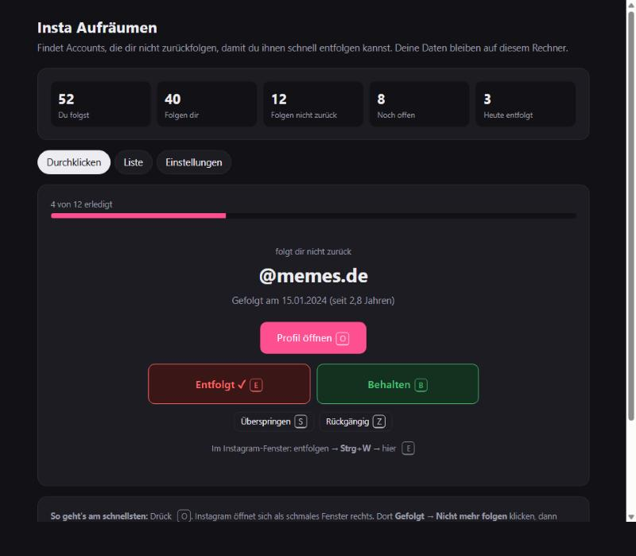

# Insta Aufräumen

Finde heraus, wer dir auf Instagram nicht zurückfolgt, und entfolge diesen Accounts schnell per Tastatur. Das Tool läuft **komplett lokal**, braucht **keinen Login** und klickt **nichts automatisch** für dich.

**➜ [Direkt im Browser öffnen](https://honz221.github.io/insta-aufraeumen/)**, oder `insta-aufraeumen.html` herunterladen und per Doppelklick öffnen.

## Warum noch ein Unfollow-Tool?

Die meisten Tools wollen dein Instagram-Passwort oder entfolgen per Skript automatisch. Beides verstößt gegen die Nutzungsbedingungen von Instagram und kann zur Sperre deines Accounts führen. Dieses Tool macht es anders:

- 🔒 **Deine Daten bleiben auf deinem Rechner.** Es wird nichts hochgeladen, es gibt keinen Server und kein Tracking.
- 🙅 **Kein Login, keine Automatik.** Du entfolgst selbst, das Tool sorgt nur dafür, dass es schnell geht.
- ⌨️ **Schneller Durchklick-Modus.** Pro Account dauert es nur wenige Sekunden: `O` öffnet das Profil, du entfolgst, schließt mit `Strg+W` und drückst `E`.
- ✅ **„Behalten“-Markierung.** Freunde und Lieblings-Accounts tauchen nie wieder auf.
- 🛑 **Tageslimit mit Warnung**, damit Instagram dich nicht drosselt.
- 💾 **Fortschritt sichern.** Beim nächsten Export siehst du nur die neuen Accounts.

## So funktioniert's

### 1. Instagram-Export anfordern
1. Instagram → **Einstellungen → Kontenübersicht**
2. **Deine Informationen und Berechtigungen → Deine Informationen herunterladen**
3. **Einige deiner Informationen** → nur **„Follower und gefolgte Personen“** auswählen
4. **Auf Gerät herunterladen**: Zeitraum **Gesamter Zeitraum**, Format **JSON** (nicht HTML!)
5. Nach ein paar Minuten kommt eine Mail mit dem Download-Link

### 2. Export ins Tool ziehen
Die ZIP-Datei einfach in das Tool ziehen. Alternativ gehen auch die einzelnen Dateien `followers_1.json` und `following.json`.

### 3. Durchklicken
| Taste | Aktion |
|---|---|
| `O` | Profil öffnen (als schmales Fenster rechts) |
| `E` | Entfolgt, weiter zum nächsten |
| `B` | Behalten, taucht nie wieder auf |
| `S` | Überspringen |
| `Z` | Rückgängig |

Am schnellsten geht es so: **Gefolgt → Nicht mehr folgen → `Strg+W` → `E`**

> Warum `Strg+W`? Instagram trennt aus Sicherheitsgründen die Verbindung zu dem Fenster, das es geöffnet hat. Das Tool kann das Instagram-Fenster deshalb nicht selbst schließen.

### 4. Stand sichern
Der Fortschritt wird automatisch im Browser gespeichert. Zur Sicherheit kannst du ihn unter **Einstellungen → „Stand als Datei sichern“** als Datei exportieren. Beim nächsten Mal ziehst du einfach den neuen Export und die Sicherungsdatei zusammen ins Tool.

## Tipp: Accounts, die du nicht mehr ansiehst

Dafür hat Instagram selbst eine Funktion: In der App unter **Profil → Gefolgt → „Am wenigsten interagiert“**.

## Hinweise

- Benötigt einen aktuellen Browser (Chrome, Edge, Brave, Firefox, Safari). Für ZIP-Dateien wird beim Öffnen einmalig [JSZip](https://stuk.github.io/jszip/) von cdnjs geladen.
- Gelöschte oder umbenannte Accounts zeigen bei Instagram „Seite nicht verfügbar“. Diese einfach mit `E` wegklicken.
- Instagram ändert gelegentlich das Format des Exports. Falls etwas nicht klappt, eröffne bitte ein Issue.

## Haftungsausschluss

Dieses Projekt steht in keiner Verbindung zu Instagram oder Meta Platforms, Inc. „Instagram“ ist eine Marke von Meta Platforms, Inc. Die Nutzung erfolgt auf eigene Verantwortung.

## Lizenz

[MIT](LICENSE)

---

### English

**Insta Aufräumen** ("Instagram clean-up") is a single-file, fully local web tool. You load your Instagram data export, see who doesn't follow you back and step through them quickly with keyboard shortcuts. There's no login and no automation, and nothing leaves your computer. The UI is currently German only.
